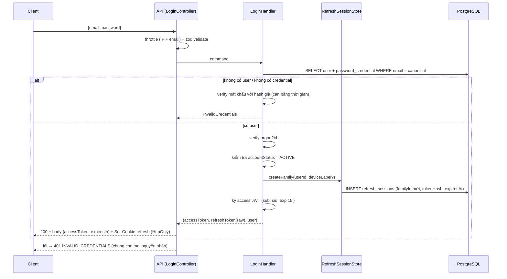

# Shanflow — Phase 3 Authentication Architecture (Vertical Slice)

Trạng thái: **Proposal — chờ Project Owner duyệt**, chưa có code, schema hay migration.
Nền tảng: [ADR-001](data-decisions.md) (email/password + Google OAuth) và
[ADR-010](data-decisions.md) (User + PasswordCredential + OAuthAccount + RefreshSession).
Phạm vi Phase 3 MVP: **register, login, refresh, logout, me**. Google OAuth, email
verification và password reset là slice mở rộng (mục 8), không chặn MVP.
Mọi mục đánh dấu **[Quyết định]** là điểm cần Project Owner chốt; cột "Đề xuất" là giá trị
mặc định nếu không có phản hồi.

## 1. Nguyên tắc Vertical Slice

- Một slice = một use case end-to-end (route, validation, logic, truy cập DB, test).
  Thêm hoặc xóa use case chỉ chạm một thư mục.
- Slice **không import slice khác**. Code dùng chung chỉ nằm ở `shared/` (kỹ thuật,
  không có nghiệp vụ) hoặc `features/auth/shared/` (nghiệp vụ auth dùng chung: phát
  token, repository session). Rule này cần được lint chặn (`no-restricted-imports`).
- Không có tầng `repository` chung cho cả app. Slice dùng `PrismaService` trực tiếp
  cho truy vấn của mình; chỉ logic phức tạp, tái sử dụng thật sự (rotation refresh,
  phát token) mới đưa vào `auth/shared`.
- Dữ liệu vào/ra của slice là contract riêng (zod schema). Frontend và backend dùng
  chung hợp đồng qua `packages/contracts` (mục 2.3), không import code nội bộ của nhau.

## 2. Cấu trúc thư mục

### 2.1 Backend — `apps/api/src`

```
src/
  app.module.ts
  config/                      # đã có; thêm biến auth (mục 6)
  database/                    # đã có: PrismaModule/PrismaService
  shared/                      # kỹ thuật thuần, không biết "auth"
    crypto/
      password-hasher.ts       # interface + argon2id impl (inject được, mock được)
      secure-token.ts          # random 256-bit, SHA-256 hash, so sánh constant-time
    http/
      problem-details.filter.ts   # map lỗi domain -> HTTP, không lộ chi tiết
      zod-validation.pipe.ts
    rate-limit/                # throttler config + key theo IP/email
    clock.ts                   # inject thời gian để test expiry/rotation
  features/
    auth/
      auth.module.ts           # chỉ đăng ký các slice + shared
      shared/
        access-token.service.ts   # ký/xác minh JWT access
        refresh-session.store.ts  # tạo, rotate, revoke family (transaction + lock)
        auth-cookie.ts            # set/clear refresh cookie
        jwt-auth.guard.ts         # xác minh access token, nạp principal
        current-principal.decorator.ts
        auth.errors.ts            # InvalidCredentials, SessionReuse, ...
      register/
        register.controller.ts    # POST /auth/register
        register.handler.ts       # logic use case
        register.schema.ts        # zod request/response
        register.handler.spec.ts  # unit
        register.db-spec.ts       # integration với PostgreSQL thật
      login/
        login.controller.ts       # POST /auth/login
        login.handler.ts
        login.schema.ts
        login.*.spec.ts
      refresh/
        refresh.controller.ts     # POST /auth/refresh
        refresh.handler.ts
        refresh.*.spec.ts
      logout/
        logout.controller.ts      # POST /auth/logout, POST /auth/logout-all
        logout.handler.ts
      me/
        me.controller.ts          # GET /auth/me (guard bắt buộc)
        me.handler.ts
      # sau MVP: google/, verify-email/, forgot-password/, change-password/
    workspace/ project/ task/  # các feature nghiệp vụ, dùng guard từ auth/shared
```

Controller mỏng (parse + gọi handler + trả response); handler giữ toàn bộ logic và
nhận phụ thuộc qua constructor (`PrismaService`, `PasswordHasher`, `Clock`, store).

### 2.2 Frontend — `apps/web/src` (Next.js 16 App Router)

Repo ghi rõ Next 16 có thay đổi so với kiến thức cũ; trước khi code đọc
`node_modules/next/dist/docs/01-app/02-guides/authentication.md` và
`01-getting-started/16-proxy.md` (`middleware` đã đổi thành `proxy`).

```
src/
  app/                          # chỉ routing, mỗi page import 1 slice
    (auth)/login/page.tsx
    (auth)/register/page.tsx
    (app)/layout.tsx            # vùng đã đăng nhập
    proxy.ts                    # chặn route theo cookie/session, chỉ là lớp UX
  features/
    auth/
      shared/
        session-store.ts        # access token giữ trong memory, không localStorage
        auth-client.ts          # single-flight refresh (một refresh tại một thời điểm)
        require-auth.tsx
      register/
        register-form.tsx
        register.action.ts      # gọi API, map lỗi -> field error
        register.schema.ts      # dùng contract chung
        register-form.test.tsx
      login/
        login-form.tsx
        login.action.ts
        login.schema.ts
      logout/
        logout-button.tsx
      session/
        use-session.ts          # hydrate: gọi refresh rồi /auth/me khi tải trang
  shared/
    api/http-client.ts          # fetch wrapper: gắn Bearer, credentials, retry 401 một lần
    ui/                         # component không nghiệp vụ
```

### 2.3 Contract dùng chung — `packages/contracts`

Thư mục `packages/` đang trống nhưng đã nằm trong workspace. Đề xuất package
`@shanflow/contracts` chứa zod schema và type của request/response từng slice
(`register`, `login`, `refresh`, `me`) và mã lỗi. Backend validate bằng đúng schema
mà frontend dùng, tránh lệch hợp đồng. **[Quyết định]** Đề xuất: tạo package này.
Phương án thay thế: backend sinh OpenAPI rồi frontend sinh client, nặng hơn cho MVP.

## 3. Quyết định kỹ thuật cần chốt

| # | Chủ đề | Đề xuất | Lý do / lựa chọn khác |
| --- | --- | --- | --- |
| D1 | Access token | JWT, TTL 15 phút, claim tối thiểu `sub`, `sid` (session id), `iat`, `exp`, `iss`, `aud`. Ký EdDSA (Ed25519) hoặc HS256 | Không nhét role/workspace vào JWT: quyền kiểm tra tại service theo DB (CDB-002). HS256 đơn giản hơn nếu chỉ có một API |
| D2 | Refresh token | **Opaque** 256-bit ngẫu nhiên, lưu `tokenHash` (SHA-256), không dùng JWT | Khớp ADR-010 (hash-only, revoke được). Refresh dạng JWT vẫn phải lưu server nên không có lợi |
| D3 | Nơi giữ token | Refresh trong cookie `HttpOnly; Secure; SameSite=Strict; Path=/auth`. Access trả trong body, client giữ trong memory | Chống XSS đọc refresh. Dev trên `localhost` cùng site nên Strict dùng được; production cần web và API cùng site |
| D4 | CSRF | SameSite=Strict + kiểm tra `Origin` allowlist + yêu cầu header tùy biến `X-Requested-With` trên `/auth/refresh` và `/auth/logout*` | Đủ cho MVP, không cần CSRF token riêng |
| D5 | Hash mật khẩu | argon2id (gói `argon2`, tham số theo OWASP: m≥19 MiB, t≥2, p=1) | Cần native build, phải thêm vào `allowBuilds`. Phương án không dependency: `crypto.scrypt` của Node |
| D6 | Refresh rotation | Mỗi lần refresh tạo session mới, đánh dấu cũ `usedAt`/`replacedById`; dùng lại token đã dùng → thu hồi cả family | Theo ADR-010. Cần khóa family (mục 4.4) |
| D7 | Race refresh (nhiều tab) | Không có grace window; client dùng single-flight + BroadcastChannel để một tab refresh | Grace window làm yếu phát hiện reuse. Có thể thêm ≤ 10 s sau nếu thực tế cần |
| D8 | TTL refresh | 30 ngày tuyệt đối, không sliding vượt quá family `expiresAt` | Giới hạn tuổi family |
| D9 | Email verification | Register tạo `emailVerifiedAt = null`. Login được, nhưng `me` trả cờ `emailVerified`; slice verify làm sau | ADR-010: chưa có token verify. Liên kết Google phải chờ verify |
| D10 | Chống dò email | Login luôn trả `INVALID_CREDENTIALS` cùng thời gian (hash giả khi không có user). Register trùng email trả 409 kèm rate limit | Phản hồi chung cho register cần email verification mới có ý nghĩa, để sau |
| D11 | Personal Workspace | Register **không** tạo workspace. Tạo ở slice workspace (`ensure personal workspace`) sau đăng nhập đầu tiên | Giữ auth độc lập; bootstrap owner cần transaction riêng (CDB-003). Phương án khác: cùng transaction với register |
| D12 | Rate limit | `@nestjs/throttler`: register 5/giờ/IP; login 10/15 phút/(IP+email) và 50/15 phút/IP; refresh 30/phút/IP | Lưu bộ nhớ cho MVP; cần Redis khi chạy nhiều instance |
| D13 | Tài khoản SUSPENDED | Login bị từ chối; refresh bị từ chối; session hiện có bị revoke | Theo authorization-matrix: account ACTIVE là điều kiện bắt buộc |

## 4. Luồng dữ liệu

Quy ước: **Client** = trình duyệt (Next.js), **API** = controller + pipe/guard,
**Handler** = service của slice, **DB** = PostgreSQL qua `shanflow_app`.

### 4.1 Đăng ký — `POST /auth/register`

```mermaid
sequenceDiagram
  participant C as Client (register-form)
  participant A as API (RegisterController)
  participant H as RegisterHandler
  participant D as PostgreSQL
  C->>A: {email, password, displayName}
  A->>A: throttle + zod validate (độ dài mật khẩu, email hợp lệ)
  A->>H: command
  H->>H: normalizeEmail (trim + lowercase, ADR-010)
  H->>H: argon2id hash (ngoài transaction)
  H->>D: BEGIN; INSERT users; INSERT password_credentials; COMMIT
  alt trùng email (unique violation P2002)
    H-->>A: EmailAlreadyRegistered
    A-->>C: 409 problem+json
  else thành công
    H-->>A: {userId, email, displayName, emailVerified:false}
    A-->>C: 201
  end
```

- Hash chạy **trước** transaction để không giữ kết nối DB trong lúc tốn CPU.
- Tính duy nhất dựa vào unique index `users.email` (canonical) chứ không dựa vào
  "kiểm tra rồi insert", nên an toàn khi đăng ký đồng thời.
- Register **không** tự đăng nhập (đơn giản cho MVP); client chuyển sang trang login.
  **[Quyết định]** Đề xuất: không auto-login.

### 4.2 Đăng nhập & cấp phát token — `POST /auth/login`



- Mật khẩu sai, email không tồn tại, thiếu credential (tài khoản chỉ có Google) đều
  trả cùng một lỗi. SUSPENDED có thể trả 403 riêng **[Quyết định]**; đề xuất gộp vào
  `INVALID_CREDENTIALS` để không lộ trạng thái tài khoản.
- Refresh token thô chỉ tồn tại trong response và cookie; DB chỉ lưu SHA-256 hash.
- Nếu hash cần nâng cấp tham số (`needsRehash`), cập nhật hash sau khi verify thành công.

### 4.3 Gọi API được bảo vệ

```
Client --Authorization: Bearer <access>--> JwtAuthGuard
  guard: verify chữ ký/iss/aud/exp  -> principal {userId, sessionId}
  handler nghiệp vụ: kiểm tra ACTIVE account + membership + role theo DB
```

Access token chỉ chứng minh danh tính. Quyền workspace luôn được kiểm tra tại service
theo [authorization-matrix](authorization-matrix.md), không suy ra từ token (CDB-002).
Session đã revoke vẫn dùng được access token đến khi hết hạn (tối đa 15 phút); đây là
đánh đổi chấp nhận của JWT ngắn hạn. Thao tác nhạy cảm sau này (đổi mật khẩu, link
Google) cần kiểm tra thêm `sid` còn hiệu lực trong DB.

### 4.4 Làm mới token — `POST /auth/refresh`

```mermaid
sequenceDiagram
  participant C as Client (single-flight)
  participant A as API (RefreshController)
  participant S as RefreshSessionStore
  participant D as PostgreSQL
  C->>A: cookie refresh (không body) + header X-Requested-With
  A->>A: kiểm tra Origin + header + throttle
  A->>S: rotate(rawToken)
  S->>S: hash = SHA-256(rawToken)
  S->>D: BEGIN
  S->>D: SELECT session WHERE tokenHash (không thấy → 401)
  S->>D: pg_advisory_xact_lock(familyId)  -- tuần tự hóa cả family
  S->>D: SELECT lại session FOR UPDATE
  alt đã usedAt / replacedById (reuse) hoặc family bị revoke
    S->>D: UPDATE family SET revokedAt = now() ; COMMIT
    S-->>A: SessionReuse
    A-->>C: 401 + xóa cookie
  else hết hạn hoặc user không ACTIVE
    S->>D: COMMIT
    A-->>C: 401 + xóa cookie
  else hợp lệ
    S->>D: INSERT session mới (cùng familyId, tokenHash mới)
    S->>D: UPDATE session cũ SET usedAt = now(), replacedById = mới
    S->>D: COMMIT
    S-->>A: {accessToken mới, refreshToken mới}
    A-->>C: 200 + Set-Cookie refresh mới
  end
```

- Khóa advisory theo `familyId` tuần tự hóa refresh và revoke cạnh tranh của cùng
  family, đúng yêu cầu "family-level lock" của ADR-010 (khóa một generation là chưa đủ).
- Hai request đồng thời cùng token: chỉ một thắng; request còn lại thấy `usedAt` và bị
  coi là reuse → toàn bộ family bị thu hồi. Vì vậy client **bắt buộc** single-flight
  (D7); đây là rủi ro UX cần test E2E nhiều tab.
- `replacedById` có unique (nullable) để một successor không có nhiều predecessor.
- Không ghi log token, hash hay cookie.

### 4.5 Đăng xuất — `POST /auth/logout`, `POST /auth/logout-all`

- `logout`: revoke family của refresh cookie hiện tại (đặt `revokedAt`), xóa cookie.
  Idempotent: token không tồn tại vẫn trả 204.
- `logout-all`: cần access token hợp lệ; revoke mọi family của `userId`.
- Đổi mật khẩu và suspend tài khoản (sau MVP) gọi cùng `revokeAllForUser`.

### 4.6 Khởi động trang phía client

1. Tải trang → `use-session` gọi `POST /auth/refresh` (cookie tự gửi).
2. Thành công → giữ access token trong memory, gọi `GET /auth/me` lấy profile.
3. Thất bại 401 → chuyển `/login`. Request API sau đó gắn Bearer; gặp 401 thì
   refresh một lần qua single-flight rồi thử lại, vẫn 401 thì đăng xuất local.

`proxy.ts` của Next chỉ đọc sự hiện diện cookie để điều hướng sớm (UX), **không** là
ranh giới bảo mật; ranh giới nằm ở API.

## 5. Mô hình dữ liệu cần thêm (migration Phase 3)

Theo ADR-010; chi tiết cuối cùng cần Auth modeling review trước khi viết schema.

| Bảng | Cột chính | Ràng buộc / index |
| --- | --- | --- |
| `password_credentials` | `user_id` PK/FK, `password_hash`, `password_updated_at`, `created_at`, `updated_at` | FK `ON DELETE RESTRICT`; hash dạng encoded argon2 (chứa tham số) |
| `refresh_sessions` | `id`, `user_id` FK, `family_id`, `token_hash` UNIQUE, `created_at`, `expires_at`, `used_at?`, `revoked_at?`, `replaced_by_id?` FK UNIQUE, `last_used_at?`, `device_label?` | Index `(user_id)`, `(family_id)`, `(expires_at)`; CHECK `expires_at > created_at`; không lưu token thô, không lưu IP mặc định |
| `oauth_accounts` | (slice Google, sau MVP) | UNIQUE `(provider, provider_account_id)` |
| `users.email_verified_at` | cột nullable thêm vào `users` | Không đổi `account_status` |

Lưu ý vận hành đã có sẵn: migration do `shanflow_migrator` chạy; `shanflow_app` nhận
CRUD qua default privileges (kiểm tra bằng test quyền như `runtime-permissions`).
Dọn session hết hạn/revoke chỉ xóa sau replay window được duyệt (job riêng, sau MVP).

## 6. Cấu hình và bí mật mới

Mở rộng `env.schema.ts` (zod, fail-fast khi khởi động):

| Biến | Ghi chú |
| --- | --- |
| `JWT_ACCESS_SECRET` hoặc `JWT_PRIVATE_KEY`/`JWT_PUBLIC_KEY` | ≥ 32 byte ngẫu nhiên hoặc cặp khóa Ed25519; không commit; thêm vào `.env.example` để trống |
| `JWT_ISSUER`, `JWT_AUDIENCE` | Chuỗi cố định, được kiểm tra khi verify |
| `ACCESS_TOKEN_TTL_SECONDS` (900), `REFRESH_TOKEN_TTL_DAYS` (30) | Giới hạn min/max trong schema |
| `AUTH_COOKIE_SECURE`, `AUTH_COOKIE_DOMAIN` | `Secure` bắt buộc true ở production |
| `WEB_ORIGIN` | Allowlist CORS (`credentials: true`) và kiểm tra `Origin` |

Cần thêm `main.ts`: `helmet`, CORS theo `WEB_ORIGIN`, `cookie-parser`, body size limit.

## 7. Thành phần cần chuẩn bị trước khi code

```
                     ┌────────────── apps/web ──────────────┐
  features/auth/*  ──► shared/api/http-client ─► (Bearer + cookie)
                     └──────────────────┬───────────────────┘
                                         │ HTTPS, CORS allowlist
                     ┌──────────── apps/api ────────────────┐
  ThrottlerGuard ─► ZodValidationPipe ─► Controller (slice)
                                           │
                                       Handler (slice) ──► PasswordHasher
                                           │             └► AccessTokenService
                                           │             └► RefreshSessionStore
                                           ▼
                                      PrismaService ──► PostgreSQL (shanflow_app)
```

Checklist chuẩn bị:

1. **Quyết định**: D1–D13 và hai điểm ở 4.1/4.2 (auto-login, mã lỗi SUSPENDED).
2. **Dependency** (kiểm tra `pnpm audit` sau khi thêm, đang còn SEC-02): `argon2`
   (thêm vào `allowBuilds`), `jose` hoặc `@nestjs/jwt`, `cookie-parser`, `helmet`,
   `@nestjs/throttler`. Không dùng lib auth tổng thể che mất luồng.
3. **Schema**: Auth modeling review → migration `password_credentials`,
   `refresh_sessions`, `users.email_verified_at` + test ràng buộc và test quyền runtime.
4. **Shared kỹ thuật**: `PasswordHasher`, `secure-token`, `Clock`, problem-details
   filter, zod pipe, cấu hình throttler.
5. **Cấu hình**: biến môi trường mục 6, sinh khóa local, cập nhật `.env.example`.
6. **Contract package**: `packages/contracts` với schema từng slice và mã lỗi.
7. **Lint rule** chặn import chéo giữa slice; quy ước đặt tên file và vị trí test.
8. **Chiến lược test** (đưa vào definition of done của mỗi slice):
   - Unit handler với hasher/clock giả.
   - DB integration trên PostgreSQL thật: unique email đồng thời, rotation đồng thời
     (chỉ một thắng), reuse → revoke family, suspend → từ chối, hết hạn.
   - E2E HTTP: cookie flags, 401 thống nhất, throttle, CORS/Origin.
   - Test bảo mật: không log secret, thời gian login không lộ tồn tại email,
     JWT sai `alg`/`iss`/`aud`/hết hạn bị từ chối (cấm `alg: none`).
9. **Frontend**: đọc docs Next 16 (auth, proxy, route handlers), chốt BFF hay gọi
   API trực tiếp **[Quyết định]** — đề xuất gọi API trực tiếp với `credentials: include`.
10. **Tài liệu**: ADR bổ sung cho D1–D8 sau khi duyệt; cập nhật authorization-matrix
    nếu thêm guard; runbook xoay khóa JWT.

## 8. Thứ tự triển khai đề xuất

| Bước | Slice / hạng mục | Điều kiện hoàn thành |
| --- | --- | --- |
| 0 | Chốt quyết định, cập nhật tài liệu này thành Accepted | Project Owner duyệt |
| 1 | Schema + migration + test quyền runtime | `db:migrate:status` sạch, test:db đạt |
| 2 | `shared/` (hasher, token, clock, filter) + cấu hình | Unit test đạt |
| 3 | `register` (BE → FE) | DB + E2E + form hoạt động |
| 4 | `login` + `auth/shared` (access token, session store, cookie) | Test timing/uniform error |
| 5 | `me` + `JwtAuthGuard` | Guard dùng được cho workspace |
| 6 | `refresh` (rotation, family lock, reuse) + client single-flight | Test đồng thời + multi-tab |
| 7 | `logout`, `logout-all` | Revoke family/all |
| 8 | Mở rộng: Google OAuth, verify email, forgot/change password | Mỗi cái một slice + review riêng |

Mỗi bước là một PR nhỏ, tự kiểm chứng được (lint, typecheck, test, build). Workspace
API và Task API vẫn **NOT READY** cho đến khi authorization service (CDB-002..004) xong;
Phase 3 chỉ mở khóa điều kiện "có danh tính đã xác thực".

## 9. Rủi ro đã biết

| Rủi ro | Giảm thiểu |
| --- | --- |
| Reuse false positive làm đăng xuất người dùng thật (multi-tab) | Single-flight client; theo dõi tỷ lệ reuse; grace window nhỏ nếu cần |
| Access token còn hiệu lực sau revoke tối đa TTL | TTL 15 phút; thao tác nhạy cảm kiểm tra `sid` trong DB |
| Argon2 tốn CPU → DoS qua login | Throttle trước khi hash; giới hạn độ dài mật khẩu tối đa (≤ 128) |
| Lộ khóa JWT | Env bí mật, xoay khóa có `kid`, không log; runbook |
| SEC-02 còn mở (braces, tooling) | Không liên quan runtime auth; vẫn chặn staging/production |
