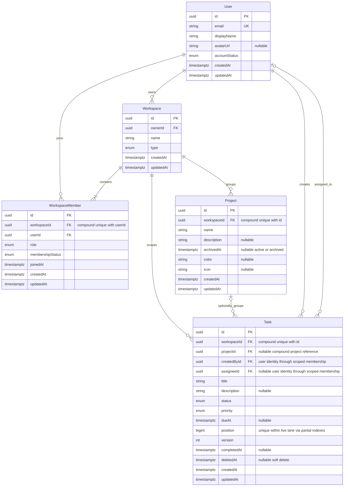
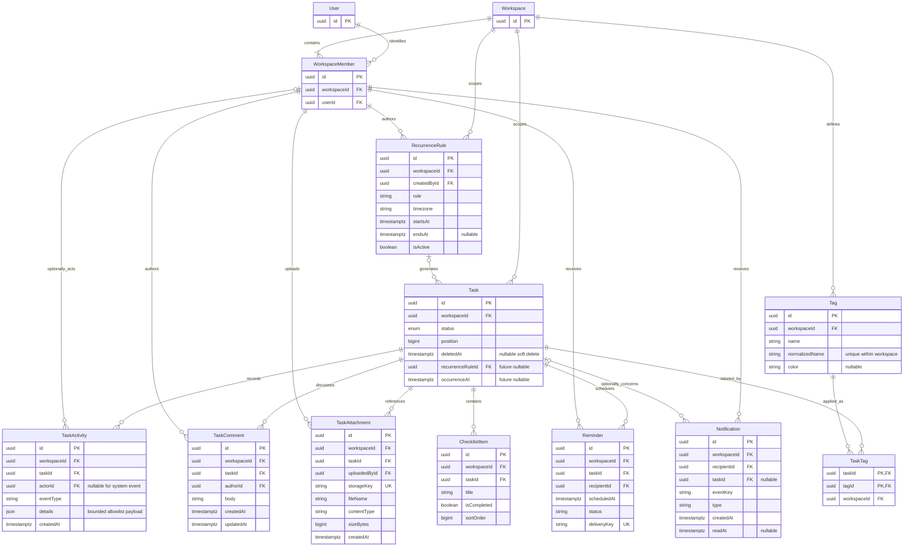

# Shanflow — ERD Design

Ngày: 2026-10-12. **11 ADR Accepted; core domain design frozen**, không phải Prisma schema hiện hữu.
Chỉ năm core domain entities trong MVP ERD. Auth dependencies có modeling phase
riêng, không lẫn future collaboration hoặc bị bỏ để giữ tổng schema năm tables.
Theo [RA-001](../security/risk-acceptance-001.md), production vẫn chưa được phép.
Xem [domain](domain-analysis.md), [permissions](authorization-matrix.md),
[decisions](data-decisions.md) để biết Design Freeze và classified implementation prerequisites.

## MVP ERD

MVP diagram biểu diễn business cardinality với User creator/assignee. Physical
creator/assignee FK đi qua WorkspaceMember compound key như bảng dưới; không
cần thêm hai redundant direct User FKs. WorkspaceMember có User FK nên identity
vẫn được bảo vệ. `|{` WorkspaceMember nghĩa mỗi workspace có ít nhất owner sau
transaction; FK đơn thuần không bảo đảm minimum-cardinality này.

## Cardinality và ownership boundaries

| Relationship | Cardinality / nullability | Proposed keys và invariant |
| --- | --- | --- |
| User ↔ Workspace (owner) | User owns 0..N; workspace có đúng 1 owner | Workspace.ownerId → User.id; PERSONAL tối đa một persisted/user qua partial unique type=PERSONAL; không Workspace archive/delete fields MVP; TEAM có thể nhiều |
| User ↔ Workspace (membership) | M:N qua WorkspaceMember; 1 row/user/workspace | Unique (workspaceId,userId); mỗi row có non-null User/Workspace FKs |
| Workspace ↔ WorkspaceMember | 1:N, workspace có 1..N members; member thuộc 1 workspace | Active OWNER khớp ownerId; PERSONAL chỉ owner |
| Workspace ↔ Project | 1:N, 0..N projects | Project.workspaceId non-null; UNIQUE (workspaceId,id) hỗ trợ compound target |
| Workspace ↔ Task | 1:N, 0..N tasks | Task.workspaceId non-null; workspace là canonical tenant boundary |
| Project ↔ Task | Project có 0..N tasks; task có 0..1 project | (Task.workspaceId,projectId) → Project(workspaceId,id); MATCH SIMPLE cho projectId null |
| User ↔ Task (creator) | User creates 0..N; task có đúng 1 creator | (workspaceId,createdById) → WorkspaceMember(workspaceId,userId); immutable creator |
| User ↔ Task (assignee) | User assigned 0..N; task có 0..1 assignee | (workspaceId,assigneeId) → WorkspaceMember(workspaceId,userId); nullable assignee, active check trong application |
| Task ↔ Tag (extension) | M:N qua TaskTag | Cả hai cùng workspace; compound FK đôi + unique pair |
| Task ↔ ChecklistItem (extension) | 1:N, task có 0..N items | Item có non-null task; scoped compound FK |

## Frozen integrity constraints — chưa triển khai

- UUID PK proposals, membership UNIQUE(workspaceId,userId), Project/Task
  UNIQUE(workspaceId,id) all rows để compound FK target vẫn valid khi soft deleted.
- Workspace ownerId non-null User FK; Member UNIQUE(workspaceId,userId). Partial
  unique(workspaceId) WHERE role=OWNER bảo vệ at-most-one. Matching ACTIVE/exactly-one
  cần ADR-011 Workspace lock + service final checks/controlled writes; deferred DB
  trigger/locking là strengthening chưa implemented. Không tuyên bố every direct SQL
  được bảo vệ; cyclic owner composite FK là alternative, chưa core relation mới.
- ADR-008: Workspace không archivedAt/deletedAt/status lifecycle hoặc archive/delete
  API/UI/job. Partial unique Workspace.ownerId WHERE type=PERSONAL trên mọi rows;
  at-most-one personal/User, bootstrap creation đảm bảo at-least-one ở service.
- ADR-007: Task.workspaceId required, projectId nullable, null=Inbox, không Project
  giả. Project UNIQUE(workspaceId,id) all rows → Task composite Project FK; MATCH
  SIMPLE bỏ project relation check khi projectId null, Workspace FK vẫn bảo vệ.
  Member composite FKs cho creator/assignee; membership existence không ACTIVE/auth.
- Project.archivedAt null=active; archive giữ Tasks/status/history. Default Task
  queries deletedAt IS NULL. Deleted task không ordinary edits/moves/reorder; restore
  check role/version/member/assignee/project, giữ completion và allocate rank mới.
- Completion CHECK: (status=DONE AND completedAt IS NOT NULL) OR (status<>DONE AND
  completedAt IS NULL); proposed version>=1, position>=0. Task.deletedAt độc lập,
  soft-deleted DONE giữ completedAt; dueAt nullable UTC instant/timestamptz.
- ADR-009: position BigInt, lane(workspaceId,projectId/Inbox,status), strict distinct
  live positions; deleted rows không reserve slots. Hai partial unique indexes:
  **Project** key(workspaceId,projectId,status,position) WHERE deletedAt IS NULL AND
  projectId IS NOT NULL; **Inbox** key(workspaceId,status,position) WHERE deletedAt
  IS NULL AND projectId IS NULL. Không thêm id vào unique key; ordinary NULL unique
  không bảo vệ Inbox. No duplicate-tolerant fallback.
- Query order position ASC (id secondary pagination only); move/status/restore allocate
  destination rank. Rebalance immediate unique guards cần unused temporary ranks +
  final ranks cùng transaction; Workspace locking/expected version/bounded retry,
  integer overflow/capacity guard như ADR-009. Không negative staging nếu chọn CHECK>=0.
- RESTRICT onDelete: Workspace→Members/Projects/Tasks, User→Workspace/Member,
  Project→Task, Member→creator/assignee; no accidental Workspace cascade. Soft-delete/
  archive không invoke physical deletion. Workspace/account purge Future ADR riêng.
- Không SET NULL cả composite tuple vì workspaceId required. Member removal unassign
  mọi tasks kể cả deleted rows trong transaction, creator giữ immutable. Cross-workspace
  task/project move bị chặn. Referencing-row temporal permissions cần service guards.

Mermaid không biểu diễn composite tuple, partial predicates, owner ACTIVE/exactly-one
hoặc locking/default query scopes. Các notes và ADR là phần bắt buộc của thiết kế.
Prisma 7.10.0 support partialIndexes preview/where predicates phải verify khi modeling;
unsupported indexes/CHECK/triggers cần SQL supplement. Chưa schema/SQL compatibility
tests; metadata diagram không thay authorization hoặc DB enforcement proof.

## Supporting authentication boundary — separate modeling

ADR-001/ADR-010 Accepted email/password + Google OAuth và supporting auth storage riêng. Năm entities trên là core domain,
không toàn bộ schema cho Auth. User.emailVerifiedAt là classified Auth-phase field; PasswordCredential
(User 0..1, userId PK/FK), OAuthAccount (User 0..N, UNIQUE provider/providerAccountId),
RefreshSession (User 0..N, tokenHash/expiry/revocation/rotation generations) cần
modeling riêng theo ADR-010 trước auth APIs. Password không plaintext; Google linking không dựa riêng
unverified email, cần authenticated reauth + validated stable provider identity.
Không thêm auth tables vào MVP ERD hoặc future collaboration diagram này, cũng
không coi chúng optional khi implementation authentication được yêu cầu.

## Future Extension ERD

Diagram sau độc lập với MVP: tất cả supporting entities là **chưa triển khai**;
Tag/TaskTag/ChecklistItem là should-have, phần còn lại Future. User/Workspace/
WorkspaceMember/Task được lặp lại tối giản làm anchors, không phải entity mới.

Extension integrity proposals: mỗi workspaceId có Workspace FK; mọi task/tag/rule
reference dùng (workspaceId,id), mọi actor/author/recipient reference dùng
(workspaceId,userId) membership key. TaskTag PK (taskId,tagId) và hai compound FKs
chặn label cross-workspace. Rule+occurrenceAt unique khi cả hai non-null để chống
duplicate recurring instances; details/templates cho generator chưa được chốt.
Notification unique (recipientId,eventKey) cho idempotence, recipient phải ACTIVE
và vẫn được phép thấy resource trước delivery/read; không send PII chỉ vì FK tồn tại.

Task soft delete giữ checklist/tags/history/files, không FK cascade; default
child visibility đi qua parent live task. Future physical purge có thể CASCADE
checklist/join tags sau approved retention; activity/comments/files/reminders/
notifications cần cancel-delivery/retention/storage cleanup policy trước triển khai.
Không suy ra cascade toàn bộ extension từ diagram. RecurrenceRule
không hard-delete nếu có instances; deactivate thay thế. Future ERD là hướng mở
rộng cần thiết kế chi tiết riêng, không cam kết schema hoặc services delivery.

## Design Freeze và relationship readiness

Hai diagrams giữ boundaries: five-core MVP và organization/collaboration Future,
không trộn full Auth tables vào core. Authentication cardinalities riêng ghi trong
notes/ADR-010, không bị coi optional để giữ tổng schema chỉ năm tables. Workspace
1..N memberships là business invariant có owner; FK đơn không enforce minimum 1.

Core design READY for Phase 2.2 planning/review theo 11 ADR; implementation vẫn NOT
AUTHORIZED theo RA-001 và production NOT APPROVED. Nếu modeling phát hiện mismatch
(Prisma overlapping scalar relations, partial index support hoặc owner cyclic guard),
phải amend ADR/migration-impact note, không silently sửa diagram/drop constraints.
